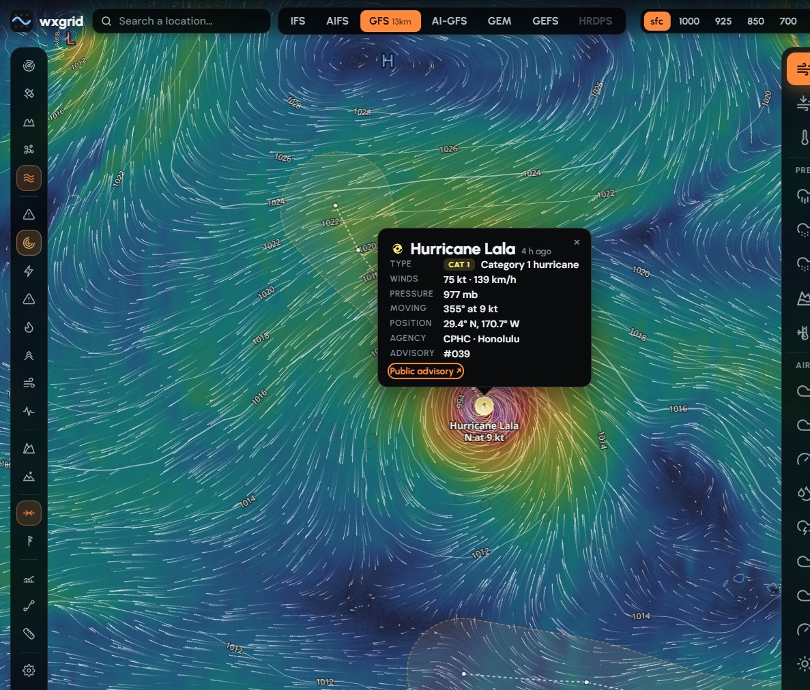
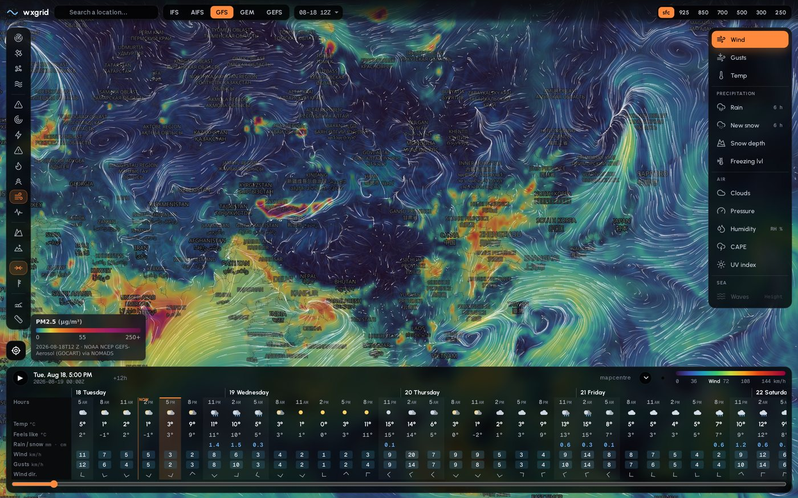

# wxgrid

A global and regional weather map you host yourself. It pulls numerical weather models from ECMWF, NOAA and Environment Canada into a local Zarr store, serves them from FastAPI, and colours the fields on the browser's GPU.

**[Live demo](https://jeffbai996.github.io/wxgrid/)** runs on a static snapshot built from the store. The source is private; this repository holds the README, screenshots and the demo build.


The raw model data behind weather apps is published keyless several times a day by ECMWF, NOAA and Environment Canada. `wxgrid` fetches it, regrids and stores it once in a compact `float16` Zarr store with a spatial point cube, and serves it to a static MapLibre GL + WebGL front end with no bundler or `node_modules`.

## Screens

| Point forecast card | Vertical cross-section |
| :---: | :---: |
|  |  |
| Conditions against the 1991–2020 normal, 15-minute rain nowcast, 48 h summary, wind rose, observations, alerts, daily strip and meteogram. | Drag a line between any two points for temperature from 1000 to 100 hPa, the 0 °C isotherm, wind barbs at each level and terrain below. |

| Skew-T sounding and radiosonde | GEFS ensemble spread |
| :---: | :---: |
|  |  |
| Model profile with parcel path, LCL, CAPE/CIN, hodograph and the nearest observed radiosonde ascent drawn in white over the model trace. | Across-member standard deviation from GEFS rendered as a Gaussian `mean ± z·σ` band rather than synthetic member traces. |

| Composite radar | Tropical cyclones and isobars |
| :---: | :---: |
|  |  |
| ECCC 1 km radar over Canada, NOAA MRMS/NEXRAD over the US and RainViewer elsewhere, switching by map position with its own timeline. | NHC, CPHC, JTWC and ATCF tracks and forecast cones, categorised on the scale of the basin where the storm sits, over MSLP isobars. |

| Synoptic globe | Dust, wind and mobile sheet |
| :---: | :---: |
|  |  |
| MapLibre GL v5 globe projection at low zoom with mean sea-level pressure contours and synoptic `H` / `L` centres. | Surface wind particles, dust and aerosol overlays, and the resizable point card (a bottom sheet over the tape on mobile, `docs/img/07-mobile.jpg`). |

## What it does and how it is built

```
ECMWF open data (IFS, AIFS, waves) ──────────┐
NOAA NOMADS (GFS, GEFS mean, GEFS-Aerosol) ──┤
NOAA AWS Open Data (AI-GFS, HRRR) ───────────┼─ wxgrid.ingest ─▶ data/store/<model>/<run>.zarr
ECCC MSC Datamart (GEM, HRDPS) ──────────────┤        │               (float16 + 24×24 point cube)
Google WeatherNext 2 Zarr (optional) ────────┘        ▼
                                               wxgrid.api (FastAPI)
                                                      │
        /api/field    one frame as 16-bit data, coloured on the browser GPU
        /api/layer    the same frame coloured on the server (no-WebGL fallback)
        /api/wind     coarse u/v vectors for the canvas particle layer
        /api/point    every variable at every step for one gridpoint
        /api/card     point card streamed as NDJSON panes
        /api/xsection vertical slice between two points
        /api/route    weather along a path at each point's ETA
        /api/ens      ensemble plumes and spread
        /api/sonde    nearest observed radiosonde ascent
                                                      │
                                                      ▼
                       front/   MapLibre GL v5 + WebGL field layer + canvas particles + tape
```

- **The field on the GPU (`/api/field` + `front/field.js`).** `/api/field/{model}/{run}/{step}/{layer}.png` sends each frame as a lossless 16-bit PNG on the model's grid: red and green carry the quantized value over the layer's range, and blue is the valid-data mask (`1` where defined, `0` where missing). `front/field.js` decodes frames under separate 80 MiB RAM and 40 MiB GPU texture budgets and draws them in a custom MapLibre WebGL layer. Every screen pixel is projected back onto the model grid, sampled with a Catmull-Rom cubic kernel in value space, blended between the two steps the timeline scrubber sits between (except step-snapped precipitation and type layers `ptype`, `tp6/24/72`, `sf6/24/72`), and looked up in a 256-entry colour ramp texture. Changing display units updates the ramp with zero network traffic, and the cursor readout reports the value the pixel was coloured from. `/api/layer` serves server-coloured PNG/WebP images as the no-WebGL fallback.
- **Float16 Zarr store and spatial point cube (`wxgrid/store.py`).** Fields are stored as `float16` against a per-variable offset and scale (temperatures as °C from `273.15`, sea-level pressure as Pa above `100000`, geopotential height in `4 m` units, visibility in `10 m` units) compressed with Blosc `zstd` (`clevel=3`, byte shuffle) — half the bytes of `float32` with worst-case rounding in the hundredths. After a run is written in `(1, ny, nx)` step chunks, ingest transposes it through a bounded 40 MiB in-memory band buffer into a point cube (`pt/<var>`, chunked `(all_steps, 24, 24)`), so a point forecast decompresses one 24×24-gridpoint tile (~50 ms) instead of every step chunk. Only the newest complete run per model keeps `pt/`; older runs answer from step chunks.
- **Point card (`/api/card`).** Tapping any point streams ten panes over NDJSON: Now (conditions against the 1991–2020 normal, a 15-minute rain nowcast, alerts, observations, a meteogram), Aloft, an airgram, Skew-T, Winter, Outdoors, a side-by-side Compare of every model on valid time, Changes (how the forecast for a fixed time has moved run over run), the GEFS Spread plume, and a ski-resort pane built from OpenStreetMap.
- **Routes, cross-sections and the tape.** `/api/xsection` slices temperature, wind barbs, freezing level and precipitation along any drawn line. `/api/route` samples weather along a multi-waypoint path at the ETA of each segment given a departure time and travel speed, flagging hazardous stretches and alert polygons crossed. The bottom forecast tape cycles through `full`, `header` and `pill` states and can be dragged to resize.
- **Offline service worker (`front/sw.js`).** Precaches the app shell from `index.html`, caches immutable `/api/field`, `/api/layer` and `/api/wind` frames per run (evicting old runs when they leave `/api/models`), and falls back to cached `/api` responses and basemap assets when offline.

## Models

Pressure levels are **1000, 925, 850, 700, 600, 500, 400, 300, 250, 200, 150 and 100 hPa** (12 levels) on 6 h steps. The API advertises only the levels and variables a stored run actually contains.

| Key | Model | Source | Grid | Steps | Surface variables | Aloft (`u v t gh`) |
|---|---|---|---|---|---|---|
| `ifs` | ECMWF IFS | `ecmwf-opendata` | 9 km → 0.25° | 3 h to 144 h, 6 h to 240 h | `u10 v10 t2m d2m msl tp sf sd gust tcc cape` + waves `swh mwd mwp pp1d swell` (6 h) | all 12 levels |
| `aifs` | ECMWF AIFS (AI) | `ecmwf-opendata` | 28 km → 0.25° | 6 h to 240 h | `u10 v10 t2m d2m msl tp sf tcc lcc mcc hcc` | all 12 levels |
| `gfs` | NOAA GFS | NOMADS filter CGI | 13 km → 0.25° | 3 h to 240 h | `u10 v10 t2m d2m msl tp sf(derived) sd gust tcc cape vis sst` | all 12 levels (+ `cc`) |
| `aigfs` | NOAA AI-GFS (AI) | AWS Open Data | 25 km → 0.25° | 6 h to 384 h | `u10 v10 t2m d2m msl tp` | all 12 levels |
| `gem` | ECCC GEM GDPS | MSC Datamart | 15 km (0.15°) → 0.25° | 3 h to 240 h | `u10 v10 t2m d2m msl tp sf sd gust tcc cape` | all 12 levels |
| `gefs` | NOAA GEFS mean | NOMADS filter CGI | 0.25° sfc / 0.5° pl → 0.25° | 3 h to 240 h | `u10 v10 t2m d2m msl tp sf(derived) sd gust tcc cape` + `t2m_sd wind_sd msl_sd tp6_sd` | `1000 925 850 700 500 250 200` (7 levels) |
| `wn2` | Google WeatherNext 2 mean | GCS Zarr (optional) | 28 km (0.25°) | 6 h to 360 h | `t2m u10 v10 msl tp sst` | all 12 levels |
| `hrdps` | ECCC HRDPS | MSC Datamart | 2.5 km → 0.025° regional | hourly to 48 h | `u10 v10 t2m d2m msl tp sf sd gust tcc` | surface only |
| `hrrr` | NOAA HRRR | AWS Open Data | 3 km → 0.025° regional | hourly to 48 h | `u10 v10 t2m d2m msl tp sf sd gust tcc` | surface only |

- **Precipitation buckets (`tp6`, `sf6`).** Stored as the accumulation since the previous stored step: ECMWF and HRRR since-start totals are differenced, GFS 6 h buckets are differenced across sub-steps, and GFS snowfall is derived from `tp6` where the categorical snow flag (`csnow`) is set.
- **Wave decomposition (`ifs`).** ECMWF open data publishes total significant wave height (`swh`) and 10–30 s period-band heights (`h1012` through `h2530`). Ingest folds the six bands in root-sum-square into `swell`, and `wxgrid/render.py` derives wind sea in quadrature at request time.
- **Regional projections (`hrdps`, `hrrr`).** Transformed from rotated lat/lon or Lambert conformal via PyProj and bilinearly sampled onto regular `0.025°` regional subgrids (`order=0` nearest-neighbour for categorical precipitation type).

## External feeds

Proxied through `wxgrid/ext.py` behind a server-side SQLite TTL cache (`data/cache/ext.sqlite3`), except feeds marked *direct*, whose tiles the browser requests directly.

| Feed | Provider | Coverage |
|---|---|---|
| Radar | ECCC GeoMet WMS (1 km, 6 min) · NOAA MRMS / IEM NEXRAD · RainViewer (*direct* tiles) | Canada · CONUS · global |
| Satellite | NASA GIBS GOES-East/West GeoColor · EUMETView Meteosat MTG geocolour (0°) and IODC natural colour (45.5°E) (*direct* tiles) | Americas, Pacific, Europe, Africa, Indian Ocean |
| Aurora | NOAA SWPC OVATION + planetary Kp | global |
| Alerts | NWS · MeteoAlarm (Atom/CAP) · BoM (CAP-AU + AMOC) · Environment Canada ALERTS WMS (*direct*) | US · Europe · Australia · Canada |
| Tropical cyclones | NHC/CPHC (`CurrentStorms.json`, KMZ) · JTWC · ATCF b-deck tracks and a-deck ensemble aids | global |
| Aviation hazards | `aviationweather.gov` SIGMET, international SIGMET, G-AIRMET | global |
| Observations | `aviationweather.gov` METAR + TAF (point and bounding-box station layer) | global |
| Radiosondes | IEM RAOB · University of Wyoming · IGRA v2 station catalog | global |
| Air quality | NOAA GEFS-Aerosol (GOCART) PM2.5, PM10, dust, AOD · Open-Meteo (CAMS) O3, NO2, AQI | global |
| Wildfires | CIFFC incidents · CWFIS M3 perimeters and hotspots · NIFC/WFIGS incidents and perimeters | Canada · US |
| Avalanche | Avalanche Canada · `avalanche.org` | Canada · US |
| Tides | DFO IWLS · NOAA CO-OPS | Canada · US |
| Earthquakes | USGS M2.5+ past day (*direct* GeoJSON) | global |
| Places & elevation | Nominatim search and reverse (rate-limited to 1 req/s) · Open-Meteo elevation | global |
| Ski resorts | OpenStreetMap via Overpass + DEM base/summit elevations | global |
| Climate normals | ERA5 1991–2020 daily via Open-Meteo archive (366-day table per 0.25° cell, cached 30 days) | global |
| Rain nowcast | Open-Meteo `minutely_15` precipitation (1 h back, 2 h ahead per 0.05° cell, cached 5 min) | global |
| Webcams | DriveBC · Windy Webcams API (optional key) | BC highways · worldwide |

Data attribution: ECMWF data is CC BY 4.0, NOAA model data is public domain, and ECCC data is used under the Environment and Climate Change Canada Data Servers End-use Licence.

---

Source code is proprietary.
