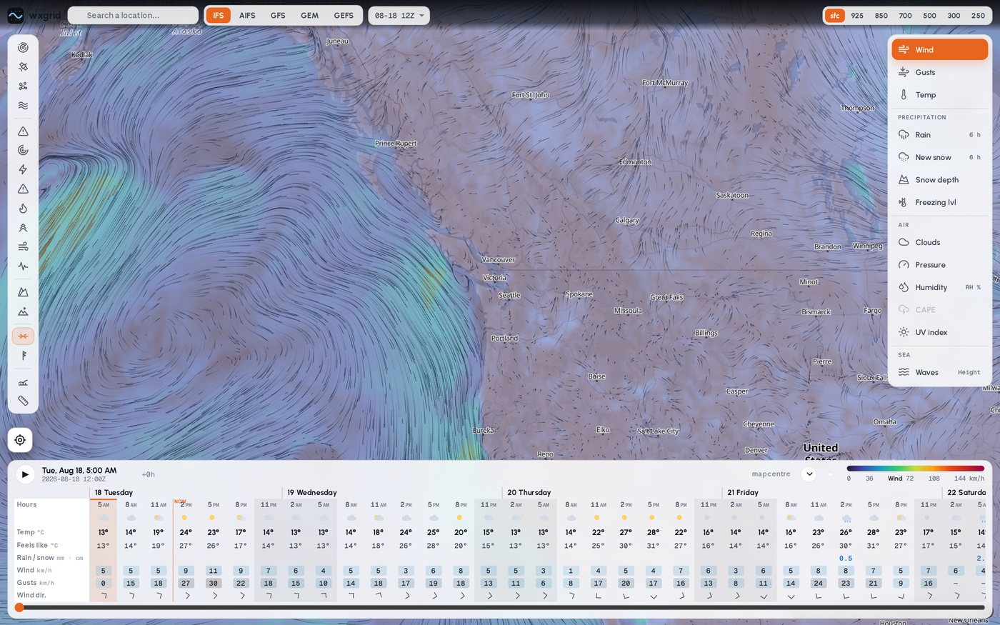
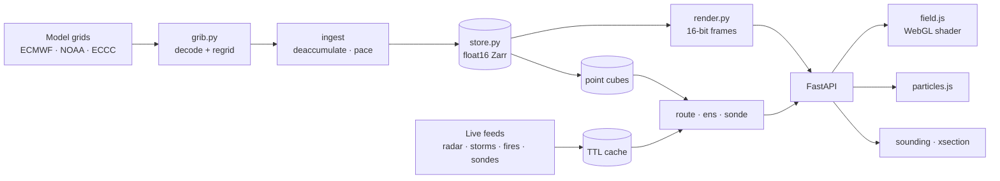

# wxgrid

Weather maps from the open forecast models, drawn on the GPU in the browser.

[](wxgrid/)
[](front/field.js)
[](https://maplibre.org/)
[](https://jeffbai996.github.io/wxgrid/)


wxgrid pulls the open forecast models (ECMWF IFS and AIFS, NOAA GFS, GEFS and HRRR, Canada's GEM and HRDPS, and a few more) into one local store, then draws them in the browser: wind particles, soundings, cross-sections, ensemble spread, radar, tropical cyclones, wildfires and forecasts along a drive. It runs on a home server. The [live demo](https://jeffbai996.github.io/wxgrid/) is a static snapshot exported from the store.

## Highlights

- Each forecast step ships once as lossless 16-bit data. A WebGL shader interpolates it bicubically in physical units, blends between steps and applies the colour ramp per pixel, so no tiles are pre-rendered per variable, level or unit.
- One `float16` Zarr store serves both the map and the point forecast. Map frames read step chunks; the point card reads a transposed `(all steps × 24 × 24)` cube that is built inside a fixed 40 MiB buffer.
- Regional models keep their resolution. HRRR (Lambert conformal) and HRDPS (rotated pole) are reprojected onto 0.025° grids; the global models share a 0.25° grid.
- Ensemble wind-speed spread is projected onto the mean wind (a delta-method approximation), because GEFS publishes u and v spread separately and naively combining them counts a change in direction as a change in speed.
- The Skew-T, hodograph, cross-section and up to 9,800 wind particles on the 3D globe all run client-side, on a zero-build front end.

## Screens

| Point forecast card | Vertical cross-section |
| :---: | :---: |
|  |  |
| Conditions against the 1991–2020 normal, 15-minute rain nowcast, 48 h summary, wind rose, observations, alerts, daily strip and meteogram. | Drag a line between any two points for temperature from 1000 to 100 hPa, the 0 °C isotherm, wind barbs at each level and terrain below. |

| Skew-T sounding and radiosonde | GEFS ensemble spread |
| :---: | :---: |
|  |  |
| Model profile with parcel path, LCL, CAPE/CIN, hodograph and the nearest observed radiosonde ascent drawn in white over the model trace. | Across-member standard deviation from GEFS rendered as a Gaussian `mean ± z·σ` band rather than synthetic member traces. |

| Composite radar | Tropical cyclones and isobars |
| :---: | :---: |
|  |  |
| ECCC 1 km radar over Canada, NOAA MRMS/NEXRAD over the US and RainViewer elsewhere, switching by map position with its own timeline. | NHC, CPHC, JTWC and ATCF tracks and forecast cones, categorised on the scale of the basin where the storm sits, over MSLP isobars. |

| Synoptic globe | Dust, wind and mobile sheet |
| :---: | :---: |
|  |  |
| MapLibre GL v5 globe projection at low zoom with mean sea-level pressure contours and synoptic `H` / `L` centres. | Surface wind particles, dust and aerosol overlays, and the resizable point card (a bottom sheet over the tape [on mobile](docs/img/07-mobile.jpg)). |

| Winter mode | Wildfires |
| :---: | :---: |
|  |  |
| New snow, snow depth, freezing level, precipitation type, terrain and avalanche regions. A resort gets an elevation-band forecast, its lift network and trail difficulty. | Active incidents and perimeters from CIFFC, CWFIS and NIFC/WFIGS, with the agency's fire number, size, stage of control and containment, over satellite hotspots. |

| Route forecast | Light theme |
| :---: | :---: |
|  |  |
| Draw a route, set a departure time and a speed, and each sample is read at its own ETA: temperature, gusts, precipitation type, freezing level, hazardous stretches and any warning crossed. | Every layer, legend and readout also comes in a light theme. |

## Architecture



Scheduled ingest workers (`wxgrid/ingest.py` and `wxgrid/fetch.py`) poll upstream HTTP and byte-range indexes in refresh-tier order (short-range regional first, then deterministic global, then ensemble), decode each GRIB2 message through `wxgrid/grib.py`, difference cumulative precipitation buckets into per-step increments (`tp6`, `sf6`), fold ECMWF's six 10–30 s wave period bands (`h1012` through `h2530`) in root-sum-square into `swell`, and write `float16` step slabs into `data/store/<model>/<run>.zarr`. Once a run completes, `build_point_cube` transposes the step chunks into `pt/<var>` (`(all_steps, 24, 24)`) for low-latency point extraction and pre-warms common `/api/field` frames.

The FastAPI server (`wxgrid/api.py` and router modules `*_api.py`) exposes the catalog (`/api/models`), 16-bit GPU data frames (`/api/field`), server-colored fallback rasters (`/api/layer`), coarse particle vectors (`/api/wind`), single-point series (`/api/point`), a 10-pane NDJSON streaming point card (`/api/card`), arbitrary great-circle vertical slices (`/api/xsection`), timed route forecasts (`/api/route`), GEFS spread plumes (`/api/ens`), and cached observational overlays (`wxgrid/ext.py`, `wxgrid/radar.py`, `wxgrid/sonde.py`, `wxgrid/fires.py`, `wxgrid/sigmet.py`, `wxgrid/resorts.py`, `wxgrid/cams.py`). The browser client (`front/`) runs directly from static ES5/ES2022 scripts without a bundler or `node_modules`.

### Models

Pressure levels are `1000, 925, 850, 700, 600, 500, 400, 300, 250, 200, 150, 100 hPa` (12 levels) on 6 h steps. The API advertises only the levels and variables a stored run actually contains.

| Key | Model | Source | Grid | Steps | Surface variables | Aloft (`u v t gh`) |
|---|---|---|---|---|---|---|
| `ifs` | ECMWF IFS | `ecmwf-opendata` | 9 km → 0.25° | 3 h to 144 h, 6 h to 240 h | `u10 v10 t2m d2m msl tp sf sd gust tcc cape` + waves `swh mwd mwp pp1d swell` (6 h) | all 12 levels |
| `aifs` | ECMWF AIFS (AI) | `ecmwf-opendata` | 28 km → 0.25° | 6 h to 240 h | `u10 v10 t2m d2m msl tp sf tcc lcc mcc hcc` | all 12 levels |
| `gfs` | NOAA GFS | NOMADS filter CGI | 13 km → 0.25° | 3 h to 240 h | `u10 v10 t2m d2m msl tp sf(derived) sd gust tcc cape vis sst` | all 12 levels (+ `cc`) |
| `aigfs` | NOAA AI-GFS (AI) | AWS Open Data | 25 km → 0.25° | 6 h to 384 h | `u10 v10 t2m d2m msl tp` | all 12 levels |
| `gem` | ECCC GEM GDPS | MSC Datamart | 15 km (0.15°) → 0.25° | 3 h to 240 h | `u10 v10 t2m d2m msl tp sf sd gust tcc cape` | all 12 levels |
| `gefs` | NOAA GEFS mean | NOMADS filter CGI | 0.25° sfc / 0.5° pl → 0.25° | 3 h to 240 h | `u10 v10 t2m d2m msl tp sf(derived) sd gust tcc cape` + `t2m_sd wind_sd msl_sd tp6_sd` | `1000 925 850 700 500 250 200` (7 levels) |
| `wn2` | Google WeatherNext 2 mean | GCS Zarr (optional) | 28 km (0.25°) | 6 h to 360 h | `t2m u10 v10 msl tp sst` | all 12 levels |
| `hrdps` | ECCC HRDPS | MSC Datamart | 2.5 km → 0.025° regional | hourly to 48 h | `u10 v10 t2m d2m msl tp sf sd gust tcc` | surface only |
| `hrrr` | NOAA HRRR | AWS Open Data | 3 km → 0.025° regional | hourly to 48 h | `u10 v10 t2m d2m msl tp sf sd gust tcc` | surface only |

### External feeds

Proxied through `wxgrid/ext.py` behind a server-side SQLite TTL cache (`data/cache/ext.sqlite3`), except feeds marked *direct*, whose tiles the browser requests directly.

| Feed | Provider | Coverage |
|---|---|---|
| Radar | ECCC GeoMet WMS (1 km, 6 min) · NOAA MRMS / IEM NEXRAD · RainViewer (*direct* tiles) | Canada · CONUS · global |
| Satellite | NASA GIBS GOES-East/West GeoColor · EUMETView Meteosat MTG geocolour (0°) and IODC natural colour (45.5°E) (*direct* tiles) | Americas, Pacific, Europe, Africa, Indian Ocean |
| Aurora | NOAA SWPC OVATION + planetary Kp | global |
| Alerts | NWS · MeteoAlarm (Atom/CAP) · BoM (CAP-AU + AMOC) · Environment Canada ALERTS WMS (*direct*) | US · Europe · Australia · Canada |
| Tropical cyclones | NHC/CPHC (`CurrentStorms.json`, KMZ) · JTWC · ATCF b-deck tracks and a-deck ensemble aids | global |
| Aviation hazards | `aviationweather.gov` SIGMET, international SIGMET, G-AIRMET | global |
| Observations | `aviationweather.gov` METAR + TAF (point and bounding-box station layer) | global |
| Radiosondes | IEM RAOB · University of Wyoming · IGRA v2 station catalog | global |
| Air quality | NOAA GEFS-Aerosol (GOCART) PM2.5, PM10, dust, AOD · Open-Meteo (CAMS) O3, NO2, AQI | global |
| Wildfires | CIFFC incidents · CWFIS M3 perimeters and hotspots · NIFC/WFIGS incidents and perimeters | Canada · US |
| Avalanche | Avalanche Canada · `avalanche.org` | Canada · US |
| Tides | DFO IWLS · NOAA CO-OPS | Canada · US |
| Earthquakes | USGS M2.5+ past day (*direct* GeoJSON) | global |
| Places & elevation | Nominatim search and reverse (rate-limited to 1 req/s) · Open-Meteo elevation | global |
| Ski resorts | OpenStreetMap via Overpass + DEM base/summit elevations | global |
| Climate normals | ERA5 1991–2020 daily via Open-Meteo archive (366-day table per 0.25° cell, cached 30 days) | global |
| Rain nowcast | Open-Meteo `minutely_15` precipitation (1 h back, 2 h ahead per 0.05° cell, cached 5 min) | global |
| Webcams | DriveBC · Windy Webcams API (optional key) | BC highways · worldwide |

## Inside this repository

| Module | Lines | What it does |
|---|---:|---|
| [`wxgrid/store.py`](wxgrid/store.py) | 543 | The `float16` Zarr v3 store: per-variable quantisation, Blosc `zstd` byte shuffle, a write pacer, run locking, and the bounded transpose into point cubes. |
| [`wxgrid/render.py`](wxgrid/render.py) | 781 | The 16-bit field encoder, colour lookup tables, Mercator resampling, coastline-safe upsampling, particle vectors and derived quantities (wave energy, UV, fog potential). |
| [`wxgrid/grib.py`](wxgrid/grib.py) | 266 | A streaming GRIB2 reader and the reprojection of Lambert and rotated-pole grids onto regular lat/lon. |
| [`wxgrid/route.py`](wxgrid/route.py) | 523 | Weather along a drive: timed waypoints, interpolation across forecast steps, a visibility estimate, hazard stretches and crossed warnings. |
| [`wxgrid/ens.py`](wxgrid/ens.py) | 347 | Ensemble spread: the wind-speed projection and the Gaussian percentile bands. |
| [`front/field.js`](front/field.js) | 656 | The MapLibre custom layer and its GLSL: decode, CPU and GPU budgets, bicubic sampling, step blending. |
| [`front/particles.js`](front/particles.js) | 501 | Wind and wave particles: seeding, spherical correction, globe culling, and keeping trails steady through pans and zooms. |
| [`front/sounding.js`](front/sounding.js) | 522 | The Skew-T log-P diagram and hodograph, with parcel ascent, CAPE and CIN, and an observed radiosonde overlay. |
| [`front/xsection.js`](front/xsection.js) | 223 | The vertical cross-section: temperature from 1000 to 100 hPa, the 0 °C line, wind barbs and terrain. |

This repository holds selected modules from a private codebase and is not runnable on its own.

## How it works

### 1. Value-space bicubic GPU field rendering (`wxgrid/render.py` and `front/field.js`)

Pre-rendered RGBA weather tiles bake in a single color ramp and timestep, and hardware bilinear filtering in RGB space blends colors across nonlinear palette stops instead of interpolating the underlying physical quantity. At the same time, browsers silently quantize 16-bit grayscale PNGs to 8 bits when decoding through a 2D canvas or WebGL texture upload.

`wxgrid/render.py` encodes each grid frame as an ordinary 8-bit-per-channel RGB PNG or lossless WebP (`encode_field`): the physical value is normalized over `FIELD_RANGE` into a 16-bit unsigned integer with the low 4 bits zeroed (`FIELD_BITS = 12`, giving `0.04 °C` resolution over a `160 °C` temperature span while reducing deflate payload size by 15–45%; categorical `ptype` retains all 16 bits), split across the red (`codes >> 8`) and green (`codes & 255`) channels, and paired with a binary validity mask in blue (`255` where defined, `0` where missing). In `front/field.js`, `decodeBlob` checks 64 texels across the decoded `ImageData` to verify that browser color management did not alter the mask channel (`px[i] !== 0 && px[i] !== 255`), uploads only the active pair of forecast steps within a 40 MiB GPU texture ceiling, and runs a fragment shader that inverse-projects each screen pixel to model `(col, row)` coordinates. Where all 16 neighboring texels carry valid data, the shader evaluates a 4×4 Catmull-Rom cubic kernel in physical value space; along coastal or regional domain boundaries where any neighbor is NaN, it falls back to validity-weighted bilinear interpolation before blending between timesteps `u_a` and `u_b` and indexing into a 256×1 RGBA lookup texture.

```glsl
  if (whole > 0.5) {
    vec4 wx = crw(f.x), wy = crw(f.y);
    float v = 0.0;
    for (int j = 0; j < 4; j++) {
      float row = 0.0;
      for (int i = 0; i < 4; i++) row += wx[i] * p[j * 4 + i].x;
      v += wy[j] * row;
    }
    return vec2(clamp(v, 0.0, 1.0), valid);
  }
  vec2 p00 = p[5], p10 = p[6], p01 = p[9], p11 = p[10];
  float w00 = (1.0 - f.x) * (1.0 - f.y) * p00.y, w10 = f.x * (1.0 - f.y) * p10.y;
  float w01 = (1.0 - f.x) * f.y * p01.y, w11 = f.x * f.y * p11.y;
  float ws = w00 + w10 + w01 + w11;
  float v = ws > 0.0 ? (w00 * p00.x + w10 * p10.x + w01 * p01.x + w11 * p11.x) / ws : 0.0;
  return vec2(v, valid);
```

### 2. Dual-layout `float16` Zarr store and bounded-memory point-cube transpose (`wxgrid/store.py`)

Map rendering and point forecasting pull along orthogonal axes of a 3D `(step, lat, lon)` array. A map layer request reads one forecast step across all `721 × 1440` gridpoints (`chunks=(1, ny, nx)`), whereas a point forecast card reads all steps across ~75 surface and upper-air variables at a single coordinate. Answering a point query directly from step-chunked arrays decompresses every step chunk of every variable. Conversely, transposing a 105-step `0.25°` variable into spatial tiles (`chunks=(all_steps, 24, 24)`) either peaks at 222 MB in RAM per variable or incurs 3× disk write amplification when staged through strided temporary files.

`wxgrid/store.py` stores fields as `float16` shifted and scaled by `encoding_for` and compressed with Blosc `zstd` (`clevel=3`, byte shuffle, which is 13% smaller overall and 33% smaller on smooth surface fields than bit shuffle because adjacent quantized `float16` values share their high byte). Once a run's step slabs are complete, `_copy_point_variable` transposes each array into `pt/<var>` (`chunks=(nt, 24, 24)`) in contiguous latitude-band groups sized to fit a fixed 40 MiB buffer (`_POINT_BUFFER_BYTES`), pacing disk writes through `_Pacer` (`60 MB/s` default) and stripping `pt/` from superseded runs via `strip_stale_point_cubes`.

```python
def _copy_point_variable(src, arr, pacer) -> None:
    """Transpose a map-chunked variable into point chunks, band group at a
    time. Peak buffer is `_POINT_BUFFER_BYTES` plus one decoded source chunk;
    a variable that fits the budget whole is one pass and one read each."""
    nt, ny, nx = src.shape
    band_bytes = nt * POINT_TILE * nx * src.dtype.itemsize
    rows = max(1, _POINT_BUFFER_BYTES // band_bytes) * POINT_TILE
    for y0 in range(0, ny, rows):
        height = min(rows, ny - y0)
        buf = np.empty((nt, height, nx), dtype=src.dtype)
        for t0 in range(0, nt, src.chunks[0]):
            t1 = min(t0 + src.chunks[0], nt)
            buf[t0:t1] = src[t0:t1, y0:y0 + height, :]
        for b0 in range(0, height, POINT_TILE):
            band = buf[:, b0:b0 + POINT_TILE, :]
            pacer.spend(band.nbytes)
            arr[:, y0 + b0:y0 + b0 + band.shape[1], :] = band
        del buf
```

### 3. Delta-method ensemble wind-speed spread (`wxgrid/ens.py`)

Pulling all 50 perturbed members of ECMWF `aifs-ens` across 62 steps for a single variable requires ~1.9 GB and ~26 minutes of byte-range requests (`AIFS_ENS_COST`), because each GRIB2 message is a compressed global field without spatial random access. `wxgrid` instead ingests the precomputed GEFS ensemble spread (`gespr`) fields into the Zarr store. However, NOMADS publishes ensemble standard deviations for the zonal (`u10_sd`) and meridional (`v10_sd`) wind components separately, never for scalar wind speed. Taking `√(σu² + σv²)` measures the spread of the wind *vector*, counting directional disagreement across members as speed disagreement and over-widening the speed plume whenever a trough or front shifts wind direction.

`wind_speed_spread` in `wxgrid/ens.py` applies a first-order Taylor (delta-method) expansion of scalar speed `S = √(u² + v²)` around the ensemble mean wind `(ū, v̄)`, projecting the component variances onto the mean wind direction (`σ_S ≈ √((ū²σu² + v̄²σv²) / (ū² + v̄²))`). Because that projection degenerates when the mean wind vanishes, it blends linearly into the isotropic vector spread below `CALM_MS = 2.0 m/s`.

```python
    su = np.asarray(su, dtype=np.float32)
    sv = np.asarray(sv, dtype=np.float32)
    vector = np.hypot(su, sv)
    if u is None or v is None:
        return vector
    u = np.asarray(u, dtype=np.float32)
    v = np.asarray(v, dtype=np.float32)
    spd2 = u * u + v * v
    with np.errstate(invalid="ignore", divide="ignore"):
        along = np.sqrt((u * u * su * su + v * v * sv * sv) / np.where(spd2 > 0, spd2, np.nan))
    along = np.where(np.isfinite(along), along, vector)
    w = np.clip(np.sqrt(spd2) / CALM_MS, 0.0, 1.0)
    return (w * along + (1.0 - w) * vector).astype(np.float32)
```

## Stack

| Layer | Technologies |
|---|---|
| Backend (`Python 3.12+`) | FastAPI, Uvicorn, Zarr v3 (`zarr`, `BloscCodec` with `zstd`), NumPy, SciPy (`ndimage.map_coordinates`, `ndimage.zoom`, `distance_transform_edt`), xarray, ecCodes (`eccodes`), PyProj (`CRS`, `Transformer`), Pillow, Requests, SQLite (`sqlite3` disk TTL caches) |
| Frontend (`JavaScript`) | MapLibre GL JS v5 (Web-Mercator and 3D globe projections, `CustomLayerInterface`), WebGL2 and WebGL1 (`GLSL ES 3.00` / `1.00` shaders), HTML5 Canvas 2D (`OffscreenCanvas`, `Path2D`), Service Worker Cache API (`front/sw.js`), zero bundler or `node_modules` |
| Data sources | ECMWF Open Data (`IFS`, `AIFS`, ocean wave spectra), NOAA NOMADS and AWS Open Data (`GFS`, `GEFS`, `AI-GFS`, `HRRR`, `GEFS-Aerosol`), Environment and Climate Change Canada MSC Datamart and GeoMet (`GEM GDPS`, `HRDPS`, 1 km composite radar), Google WeatherNext 2 (optional GCS Zarr), and 18 observational and hazard feeds |

## License

Source code is proprietary. Weather and observational data are used under the terms of their upstream providers: ECMWF open data is licensed under CC BY 4.0, NOAA model and observational data are in the public domain, and Environment and Climate Change Canada data is used under the Environment and Climate Change Canada Data Servers End-use Licence.
