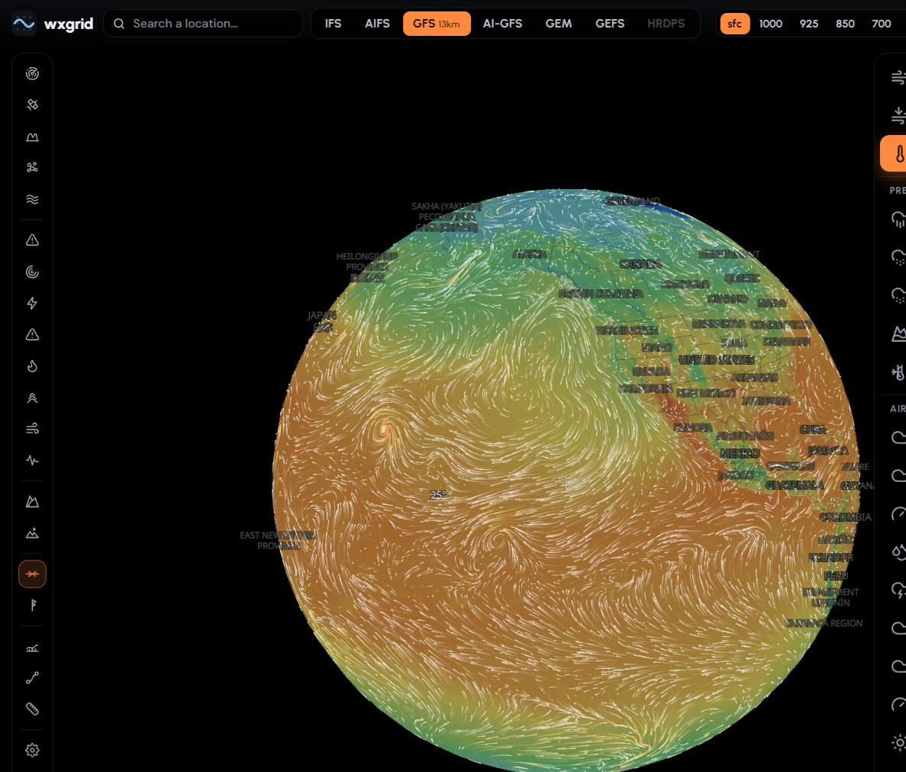

# wxgrid

Self-hosted global weather map: numerical weather model output stored as Zarr,
served by FastAPI, drawn by a static JavaScript front end.



## Install

Python 3.12+. A global 0.25° run with ten levels is about 6–7 GB on disk;
ingesting one needs a few GB of memory. `eccodes` installs as a wheel.

```bash
git clone https://github.com/jeffbai996/wxgrid && cd wxgrid
python -m venv venv && source venv/bin/activate
pip install -r requirements.txt
```

## Usage

```bash
python -m wxgrid.ingest --model aifs      # one model: ~10 min, ~130 MB of GRIB
python -m wxgrid.ingest --all             # every model; a stored run is skipped, costing one HEAD request per model
uvicorn wxgrid.api:app --port 8097        # http://127.0.0.1:8097/
scripts/smoke.sh http://localhost:8097    # point + layer + card, end to end
python -m wxgrid.liveness                 # probe every upstream by hand
```

Ingest options: `--group {regional,global,ensemble}`, `--force`,
`--augment-waves` (add waves to older IFS runs), `--point-cube` (rebuild the
point cube).

Endpoints are defined in `wxgrid/api.py` and `wxgrid/*_api.py`; model, run,
step and layer names come from `/api/models`. `/healthz` is process liveness,
`/api/health/sources` the upstream probes.

Python access to the store (from another project, put the repo on `PYTHONPATH`,
or copy `wxgrid/reader.py`, `store.py` and `config.py`, and point
`WXGRID_DATA_DIR` at the store):

```python
from wxgrid.reader import open_run, region_mean, spread
open_run("aifs")                                          # xarray Dataset, latest run
region_mean("ifs", "tp6", lat=(38, 44), lon=(-98, -85))
spread(["ifs", "aifs", "gfs"], "t2m", 49.3, -123.1)
```

### Ingest mode

`paused` (nothing runs), `simple` (default: AIFS, WN2 if configured, HRDPS;
00z and 12z only), `detailed` (every model and cycle). Set in the settings
drawer or with `GET/POST /api/mode`. `--model X` and `--group … --force`
ignore the mode. Definitions: `wxgrid/mode.py`.

Set `WXGRID_INGEST_MODELS` to a comma-separated list of model keys to restrict
scheduled passes further, for example `ifs,aifs,gfs,hrdps,hrrr`. Unset or empty
keeps the normal catalog. This selection intersects the active mode and
applies to both `--group` and `--all`; explicit `--model` and `--force` requests
bypass it. Unknown keys fail before fetching. Set the same value on each
ingest unit so a separate ensemble timer cannot fetch excluded models.

## Deployment

Units and timers are in `deploy/`; each timer runs
`python -m wxgrid.ingest --group <group>`. Cadence is in the `.timer` files.

```bash
cp deploy/*.service deploy/*.timer ~/.config/systemd/user/
systemctl --user daemon-reload
systemctl --user enable --now wxgrid.service wxgrid-ingest.timer wxgrid-ingest-regional.timer wxgrid-ingest-ensemble.timer
```

The units hard-code the checkout and venv path and the scratch directory; edit
`WorkingDirectory`, `ExecStart` and the scratch paths first. The API binds
loopback; put a reverse proxy or tunnel in front. `wxgrid-public.service`
runs a second instance with `WXGRID_PUBLIC=1`.

## Models

Keys, sources, steps, variables and levels are defined in `wxgrid/models.py`;
`/api/models` reports what a stored run actually contains.

| key | model | source |
|---|---|---|
| `ifs`, `aifs` | ECMWF IFS, AIFS | ECMWF open data |
| `gfs`, `gefs` | NOAA GFS, GEFS mean | NOMADS filter CGI |
| `aigfs`, `hrrr` | NOAA AI-GFS, HRRR | AWS Open Data |
| `gem`, `hrdps` | ECCC GEM GDPS, HRDPS | MSC Datamart |
| `wn2` | Google WeatherNext 2 ensemble mean (optional) | GCS Zarr, gated access |

Pressure levels: 1000 925 850 700 600 500 400 300 250 200 hPa. Sources on
other grids are bilinearly regridded to 0.25° (`wxgrid.grib.regrid_to_common`);
HRDPS and HRRR to a 0.025° regional subgrid. Store units are K, Pa, m/s, mm.
Fields are float16 with per-field offset and scale; the reader returns real
units. External feeds are proxied through `wxgrid/ext.py` with a TTL cache in
`$WXGRID_CACHE_DIR/ext.sqlite3`; all are keyless except the optional Windy
webcams.

Licences: ECMWF CC BY 4.0 (attribute ECMWF), NOAA public domain, ECCC Data
Servers End-use Licence.

## Configuration

Environment variables; defaults are in `wxgrid/config.py`, `wxgrid/mode.py`
and `wxgrid/ingest.py`.

| Variable | Purpose |
|---|---|
| `WXGRID_DATA_DIR` | store, GRIB scratch, caches (default `./data`) |
| `WXGRID_CACHE_DIR` | rendered layers, feed cache, liveness state |
| `WXGRID_HOST`, `WXGRID_PORT` | API bind |
| `WXGRID_KEEP_RUNS` | runs kept per model |
| `WXGRID_STATE_DIR` | holds `mode.json` |
| `WXGRID_PUBLIC` | `1` refuses to serve `front/private/` |
| `WXGRID_WRITE_MBPS`, `WXGRID_DOWNLOAD_MBPS` | ingest write and download pacing |
| `WXGRID_GRIB_RAM_DIR`, `WXGRID_GRIB_RAM_MIN_FREE` | RAM-disk GRIB scratch and its free-space floor |
| `WXGRID_WINDY_WEBCAMS_KEY` | Windy Webcams API key; unset = DriveBC cams only |
| `WXGRID_WN2_ZARR` | WeatherNext 2 collection or Zarr URL; unset = model not ingested |
| `WXGRID_STEP_GATE_COMMAND` | command run between ingest steps; non-zero exit aborts the pass |
| `WXGRID_ECMWF_ATTEMPTS`, `WXGRID_ECMWF_TRANSFER_SECONDS`, `WXGRID_ECMWF_RETRY_WAIT_SECONDS` | ECMWF retry budget |
| `WXGRID_PHASE_METRICS` | `1` logs one line per ingest phase |

## Notes

- **Hand-run ingest has no memory cap.** A run is several GB. On a shared host
  use `systemctl --user start wxgrid-ingest` or wrap the command in
  `systemd-run --user -p MemoryMax=3G --scope`.
- **`mode.json` lives outside the data dir** (`$WXGRID_STATE_DIR`, default
  `~/.local/state/wxgrid/`) so the switch is readable when the store disk is
  not.
- **`tp6`/`sf6` are amounts since the previous stored step**, despite the name.
  ECMWF and HRRR accumulations are differenced at ingest; GFS buckets are used
  as published.
- **GEFS stores seven levels** (no 600 hPa; 300/400 hPa lack temperature). Its
  Spread pane is Gaussian from σ, not member traces.
- **AI-GFS has no cloud, CAPE, gust or snow fields.** Those layers are absent,
  not inferred.
- **GEM parameters outside the stock eccodes tables decode as `unknown`.** The
  fetcher encodes the requested name in the filename and ingest forces it on
  the message.
- **HRDPS and HRRR** ingest 00/06/12/18 Z only, hourly to 48 h, two runs kept.
- **Open data has no wind-wave/swell split.** Swell is folded at ingest from
  the 10–30 s period bands; wind sea is derived at request time in quadrature.
- **WeatherNext access must already be approved** for the identity used. It
  reads Application Default Credentials (`gcloud auth application-default
  login --no-launch-browser`); `GOOGLE_APPLICATION_CREDENTIALS` takes
  precedence, and `deploy/wxgrid-ingest-wn2.conf` sets a service-account path
  that does not work with personal ADC. Keep credentials out of the repo.
  Enabling scheduled WN2 ingest is separate from a bounded trial run: see
  `docs/weathernext-dry-run.md`. The mean has no member spread. Real-time data
  carries Google's separate experimental terms; check them before serving it
  publicly.
- **The static demo's weather is frozen.** `scripts/publish_pages.sh` (and
  `python -m wxgrid.static_demo`) rebuild only the front end and reuse
  `dist-pages/api/`; refresh the data with
  `scripts/publish_pages.sh --refresh-data`, which needs a complete run in the
  store.

## Development

```bash
pip install -r requirements-dev.txt
pytest -q tests               # offline: sockets refused unless a test is marked
pytest -q -m network          # tests that reach live upstreams
node --test tests/frontend
```

Name `tests` explicitly so collection does not walk the model store.
`tests/visual/` (Playwright, not in `requirements-dev.txt`) is documented in
its own README. Conventional commits, one logical change per commit.
Memory-footprint notes: `docs/runtime-footprint.md`,
`docs/next-footprint-pass.md`.

## Licence

AGPL-3.0-or-later; see `LICENSE`. Releases up to and including `826f5db` were
published under MIT. Bundled third-party licences: `front/fonts/LICENSES.md`;
`front/vendor/maplibre-gl.js` is BSD-3-Clause and `front/data/countries.json`
(Natural Earth polygons) is public domain.
