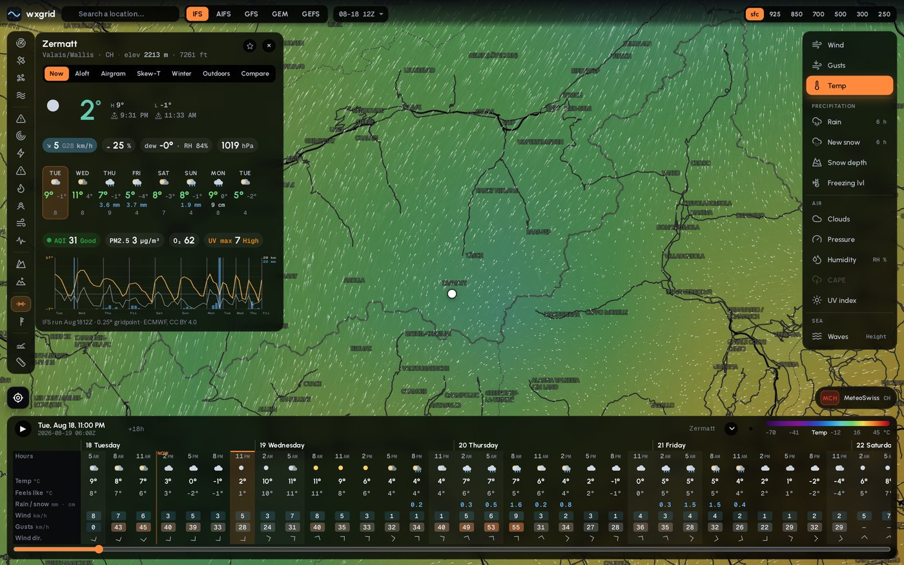
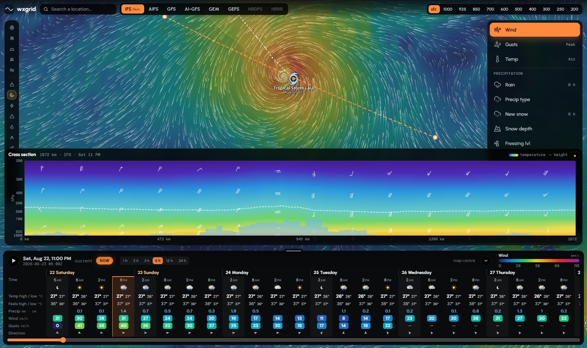
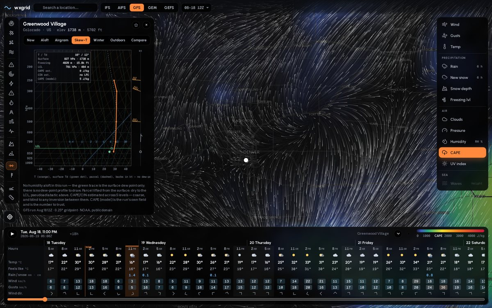
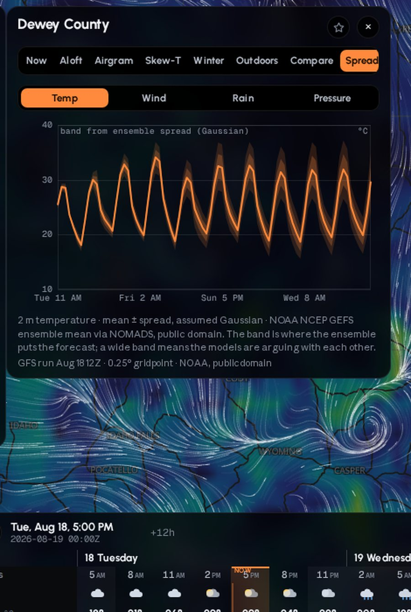
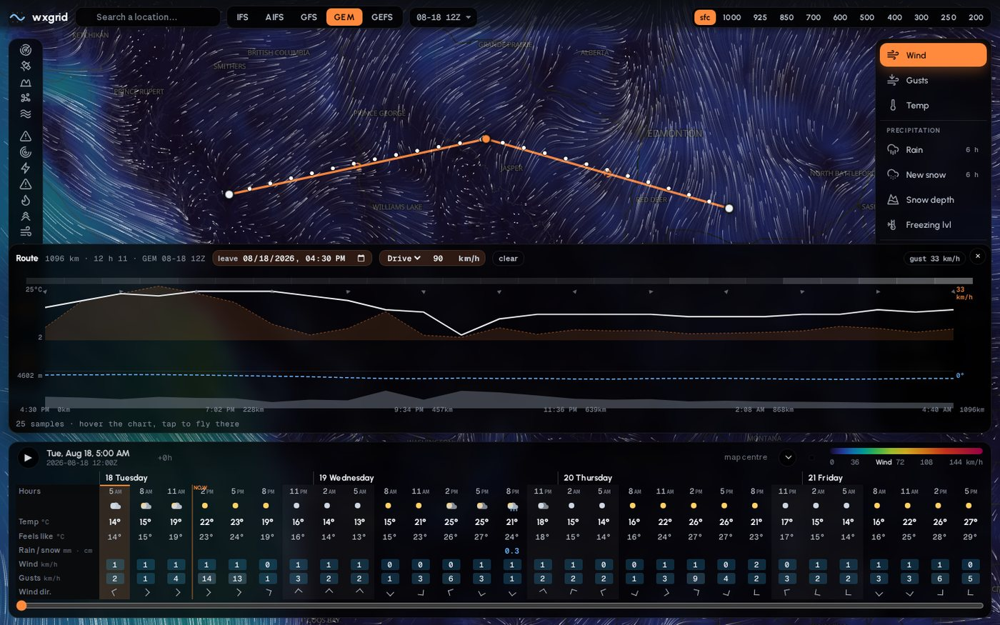
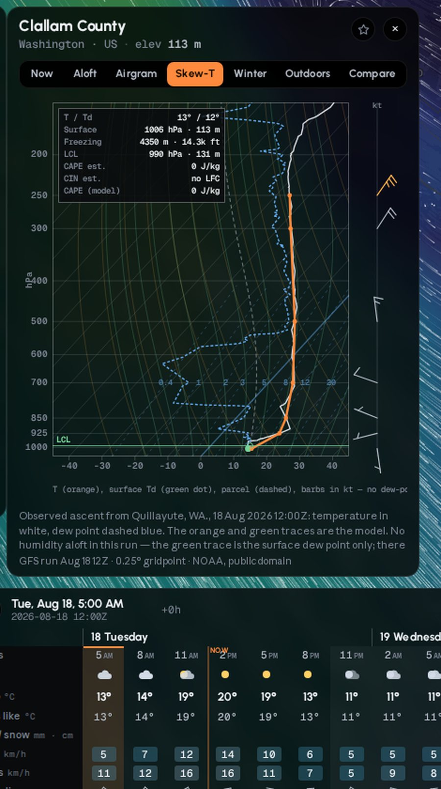
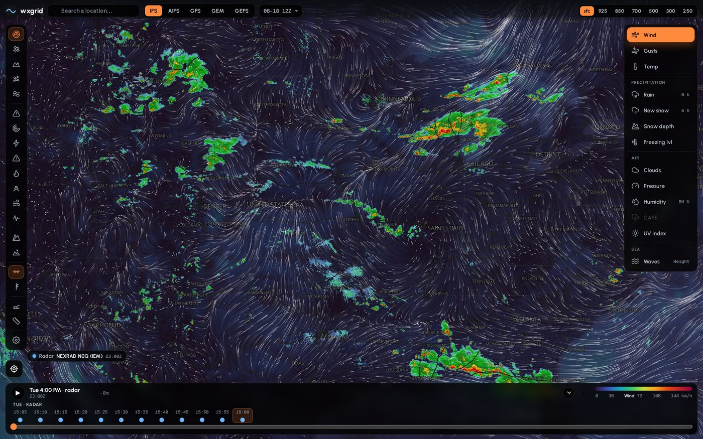
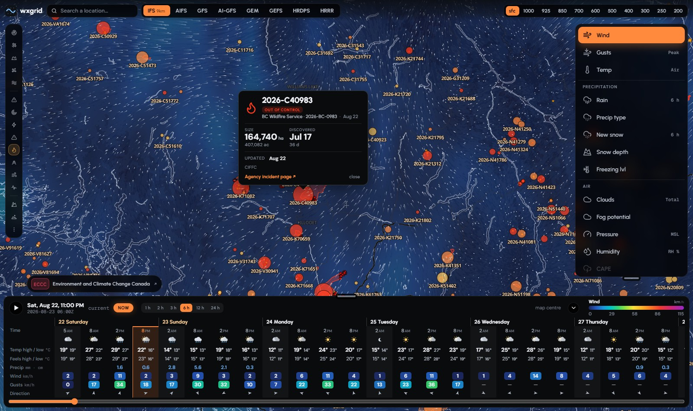
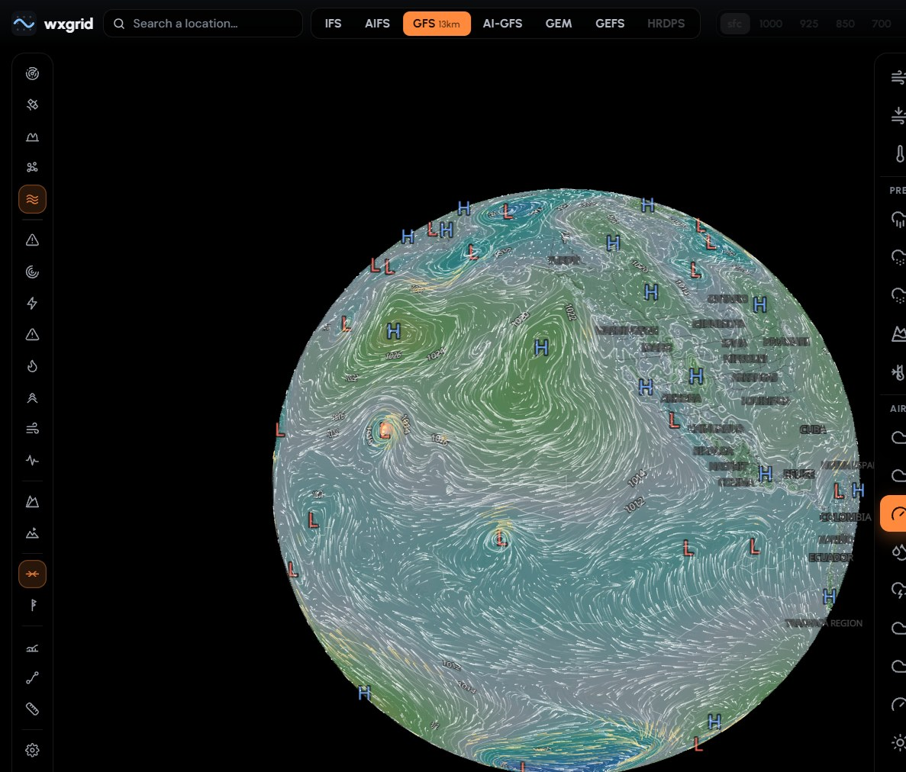
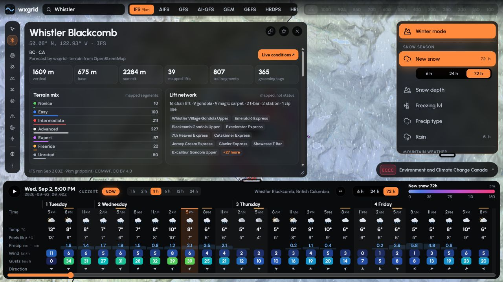

# wxgrid

Global and regional numerical weather map with multi-model comparison, vertical cross-sections, Skew-T soundings, ensemble spread, and environmental overlays.

**[Live Demo →](https://jeffbai996.github.io/wxgrid/)**

## Highlights

- **Multi-Model Forecast Engine** — unified 0.25° global and 0.025° high-resolution regional grids ingested into Zarr from ECMWF, NOAA, ECCC, and AI weather models.
- **Interactive Atmospheric Soundings & Cross-Sections** — point-click Skew-T log-P diagrams (`06-skewt.jpg`), arbitrary-path vertical cross-sections (`03-xsection.jpg`), radiosonde comparisons (`12-sonde.jpg`), and route weather profiles (`14-route.jpg`).
- **Multi-Model Ensemble & Spread Views** — side-by-side model spread (`13-spread.jpg`), point forecast cards (`02-card.jpg`), and upper-air pressure levels from 1000 hPa to 200 hPa.
- **Real-Time Environmental Overlays** — composite weather radar (`09-radar.jpg`), active wildfires & smoke (`04-fires.jpg`), air quality (`05-air.jpg`), storm tracks (`16-storm.jpg`), winter precipitation (`17-winter.jpg`), and mean sea-level pressure isobars (`15-isobars.jpg`).

## Gallery

| Point Forecast & Multi-Model Card | Vertical Cross-Section |
| :---: | :---: |
|  |  |

| Skew-T Log-P Sounding | Ensemble & Multi-Model Spread |
| :---: | :---: |
|  |  |

| Route Profile | Radiosonde Verification |
| :---: | :---: |
|  |  |

| Radar & Nowcasting | Wildfires & Air Quality |
| :---: | :---: |
|  |  |

| Synoptic Isobars | Winter Weather & Storm Systems |
| :---: | :---: |
|  |  |

## Supported Forecast Models

| Key | Model | Source |
|---|---|---|
| `ifs`, `aifs` | ECMWF IFS, AIFS | ECMWF Open Data |
| `gfs`, `gefs` | NOAA GFS, GEFS Mean | NOAA NOMADS |
| `aigfs`, `hrrr` | NOAA AI-GFS, HRRR (3 km CONUS) | AWS Open Data |
| `gem`, `hrdps` | ECCC GEM GDPS, HRDPS (2.5 km Canada) | MSC Datamart |
| `wn2` | Google WeatherNext 2 Ensemble Mean | GCS Zarr |

Data attribution: ECMWF CC BY 4.0, NOAA public domain, ECCC Data Servers End-use Licence.

---

> **Note:** Public showcase repository + static interactive demo (`gh-pages`). Source code is maintained privately.
>
> © 2026 Jeff Bai. All rights reserved.
